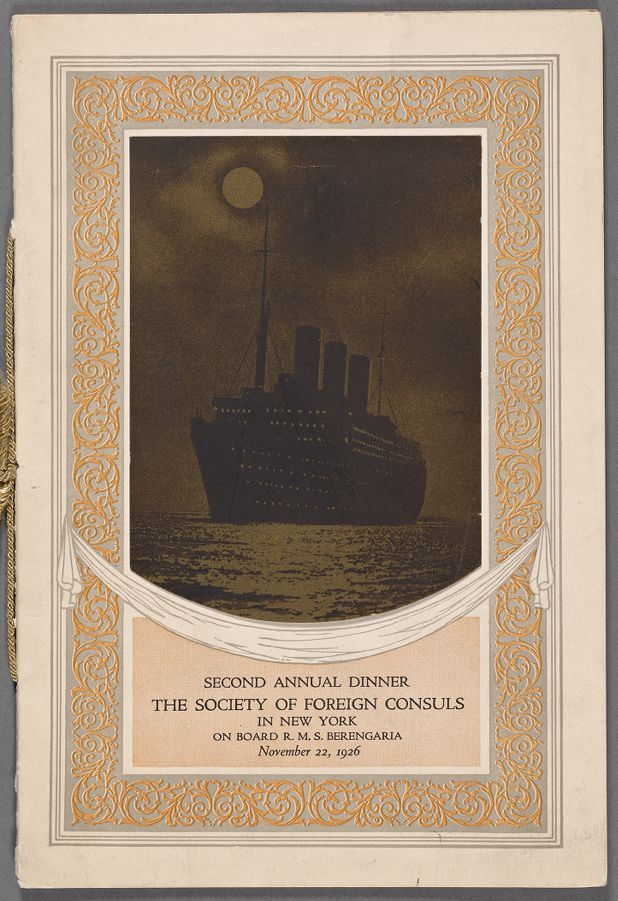
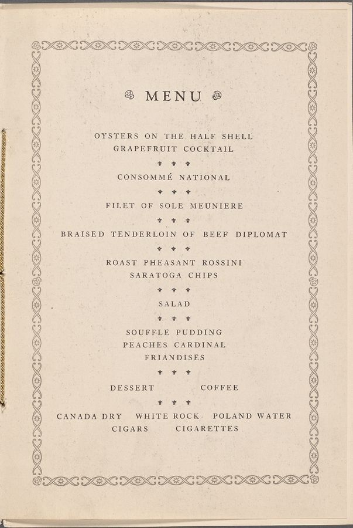
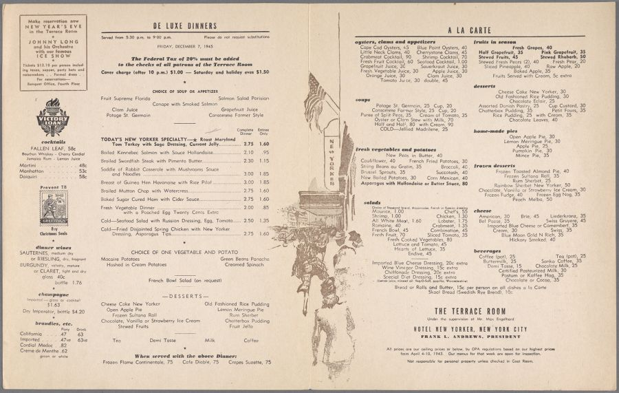

Many datasets pair structured tables with images or PDFs. Your tables hold dates
and IDs, while the text you care about only appears in the images. Quail lets
you join your tables with the images and query everything in SQL using a vision
model, a language model able to read images. See
[Querying multimodal data](/docs/user-guide/multimodal-data) for all image and
PDF functions.

The sample dataset comes from the New York Public Library
[What's on the menu?](https://www.nypl.org/research/support/whats-on-the-menu)
archive of 17,547 scanned restaurant menus. Volunteers transcribed dish names
and prices into CSV files, yet skipped everything else on the page: wartime
slogans, rationing rules, and drink lists. One SQL query joins the CSV dates
with 1,446 menu scans from 1914 to 1949 and asks two `AI.IF` questions per scan
to track World War I, Prohibition (the US ban on alcohol from 1920 to 1933),
and World War II.

`qwen3.5-4b-bf16` processes all 1,446 scans (2.1 million input tokens) in 34
seconds on one H100, or $0.04 at Modal's H100 rate. Quail encodes each scan
once and reuses KV, the model's cached attention state, across both questions.

## Browse the menus

The menus range from hotel dining rooms to ocean-liner dinners. Click any menu
to open the full image:

<div className="menu-gallery">
  <figure>

[](https://iiif.nypl.org/iiif/2/4066748/full/!2400,2400/0/default.jpg)

    <figcaption>Fraunces' Tavern, New York, July 1914</figcaption>
  </figure>
  <figure>

[](https://iiif.nypl.org/iiif/2/4049267/full/!2400,2400/0/default.jpg)

    <figcaption>Healy's 42nd St. Grill, New York, April 1918: "Buy war saving stamps"</figcaption>
  </figure>
  <figure>

[](https://iiif.nypl.org/iiif/2/4021318/full/!2400,2400/0/default.jpg)

    <figcaption>R.M.S. Berengaria, November 1926: dinner cover</figcaption>
  </figure>
  <figure>

[](https://iiif.nypl.org/iiif/2/4021321/full/!2400,2400/0/default.jpg)

    <figcaption>R.M.S. Berengaria, November 1926: mixers only, no liquor</figcaption>
  </figure>
  <figure>

[](https://iiif.nypl.org/iiif/2/4016351/full/!2400,2400/0/default.jpg)

    <figcaption>The Commodore Hotel, New York, May 1933: "Beer per glass 10c"</figcaption>
  </figure>
  <figure>

[](https://iiif.nypl.org/iiif/2/3990440/full/!2400,2400/0/default.jpg)

    <figcaption>The Hotel New Yorker, December 1945: Victory Loan notice beside cocktails</figcaption>
  </figure>
</div>

## Load the menu metadata

Start by downloading the NYPL CSV archive. Filter `Menu.csv` to menus dated
between 1914 and 1949, then count the transcribed dishes per page from
`MenuItem.csv`:

```python
import io
import random
import tarfile
import urllib.request
from concurrent.futures import ThreadPoolExecutor

import pyarrow as pa
import pyarrow.csv as csv

DATA = "https://s3.amazonaws.com/menusdata.nypl.org/gzips/2021_08_01_07_01_17_data.tgz"
with urllib.request.urlopen(DATA) as response:
    archive = tarfile.open(fileobj=io.BytesIO(response.read()))


def read(name):
    member = next(m for m in archive.getmembers() if m.name.endswith(name))
    return csv.read_csv(archive.extractfile(member),
                        parse_options=csv.ParseOptions(newlines_in_values=True))


menus = [m for m in read("Menu.csv").to_pylist()
         if m["date"] and 1914 <= m["date"].year <= 1949]
years = {m["id"]: m["date"].year for m in menus}
counts = read("MenuItem.csv").group_by("menu_page_id").aggregate([("id", "count")])
dishes = dict(zip(counts["menu_page_id"].to_pylist(), counts["id_count"].to_pylist()))
```

## Fetch one scan per menu

Pick each menu's page with the most transcribed dishes to skip decorative front
covers. Cap each year at 60 randomly sampled menus so years with hundreds of
menus do not outweigh years with few:

```python
best = {}
for page in read("MenuPage.csv").to_pylist():
    menu = page["menu_id"]
    if menu in years and dishes.get(page["id"], 0) > dishes.get(best.get(menu, {}).get("id"), -1):
        best[menu] = page

by_year = {}
for menu, page in best.items():
    by_year.setdefault(years[menu], []).append(page)
chooser = random.Random(0)
chosen = [page for found in by_year.values()
          for page in chooser.sample(found, min(60, len(found)))]
```

Download each sampled page as a JPEG resized to at most 1,024 pixels on its
longer side. Smaller sizes (512 or 768 pixels) blur small print, while larger
sizes cost more tokens without changing the answers:

```python
def fetch(page):
    url = f"https://iiif.nypl.org/iiif/2/{page['image_id']}/full/!1024,1024/0/default.jpg"
    try:
        with urllib.request.urlopen(url, timeout=15) as response:
            return response.read()
    except OSError:
        return None


with ThreadPoolExecutor(64) as pool:
    fetched = [(page, image) for page, image in zip(chosen, pool.map(fetch, chosen))
               if image]
```

Roughly one request in nine times out, leaving about 1,450 scans. Page `62899`
shows a May 1933 Commodore Hotel scan at 1,024 pixels:


## Register the tables

Build two PyArrow tables from the downloaded records and JPEG bytes:

| Table | Column | Type | Example |
| --- | --- | --- | --- |
| `menus` | `id` | `STRING` | `31142` |
| | `sponsor` | `STRING` | The Commodore Hotel |
| | `year` | `INT64` | 1933 |
| `pages` | `id` | `STRING` | `62899` |
| | `menu_id` | `STRING` | `31142` |
| | `image` | `BINARY` | JPEG bytes |

Register both tables in a Quail session configured with `qwen3.5-4b-bf16`:

```python
import quail

menus = pa.table({"id": [str(m["id"]) for m in menus],
                  "sponsor": [m["sponsor"] for m in menus],
                  "year": [m["date"].year for m in menus]})
pages = pa.table({"id": [str(page["id"]) for page, _ in fetched],
                  "menu_id": [str(page["menu_id"]) for page, _ in fetched],
                  "image": pa.array([image for _, image in fetched], pa.binary())})

config = quail.EngineConfig(model="qwen3.5-4b-bf16", device="h100-sxm")
session = quail.Session(config=config)
session.register("menus", menus, id_col="id")
session.register("pages", pages, id_col="id")
```

## Ask both questions in one query

Ask both yes-or-no questions with `AI.IF` inside a common table expression
(CTE), a named subquery, then join with `menus` and group by year:

```python
QUERY = """
WITH answers AS (
  SELECT p.menu_id,
         AI.IF(PROMPT('Does this menu sell beer, wine, or liquor to drink? Dishes cooked with wine or liqueur do not count. {0}', p.image)) AS sells_drinks,
         AI.IF(PROMPT('Does this menu mention a war, rationing, or a meatless or wheatless day? {0}', p.image)) AS mentions_war
  FROM pages p)
SELECT m.year, COUNT(*) AS menus,
       ROUND(AVG(CASE WHEN a.sells_drinks THEN 1.0 ELSE 0.0 END), 3) AS drinks,
       ROUND(AVG(CASE WHEN a.mentions_war THEN 1.0 ELSE 0.0 END), 3) AS war
FROM answers a JOIN menus m ON a.menu_id = m.id
GROUP BY m.year HAVING COUNT(*) >= 20
ORDER BY m.year
"""
print(session.sql(QUERY).collect())
session.close()
```

The first prompt excludes dishes cooked with wine or liqueur; otherwise the
model flags desserts made with port or kirsch as alcoholic drinks. Both `AI.IF`
calls read `p.image` in the same model region, so the second call reuses KV
from the first call and evaluates only its own question tokens.

## Inspect the results

`HAVING COUNT(*) >= 20` keeps every year with at least 20 menus:

<MenuHistoryTable />

Hover over the chart to inspect a single year, or click a legend entry to show
or hide a line:

<MenuHistoryChart />

War mentions jump from 2% in 1914 to 57% in 1918 during World War I, then climb
again to 38% in 1945 during World War II. Drink lists drop from 36% in 1914 to
under 10% throughout Prohibition and rebound to 30% in 1933, the year beer
became legal again. A few Prohibition menus still match: ocean-liner menus
legally serve liquor outside US waters, while the 1926 Berengaria menu lists
only mixers and is a false positive.

Two scans from the wartime peaks show the notices on the page:

<div className="menu-scans">
  <figure>


    <figcaption>Healy's 42nd St. Grill, New York, April 1918</figcaption>
  </figure>
  <figure>


    <figcaption>The Hotel New Yorker, October 1945</figcaption>
  </figure>
</div>
