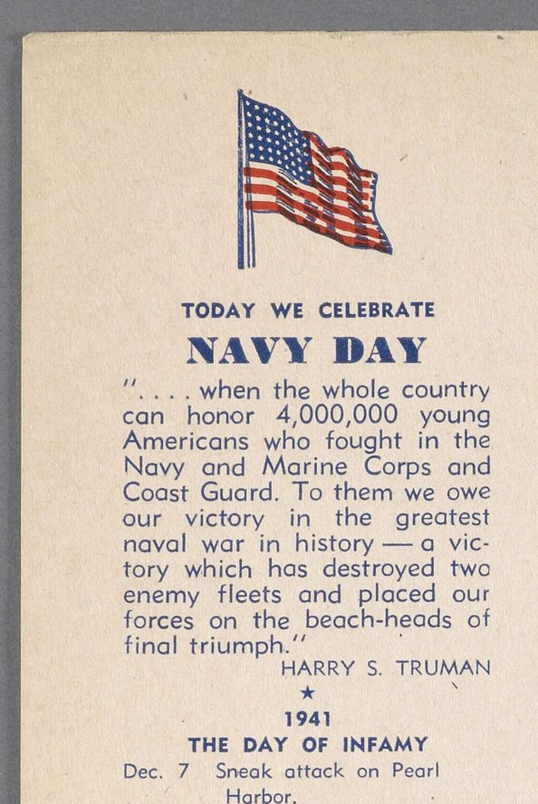

You want to know when restaurant menus stopped selling drinks, and when
menus mentioned a war. Volunteers typed in the dishes and prices of each
menu, but not the notes printed around them, so the answers exist only on
the scanned pages. Quail reads each scan with a vision model and answers
both questions in one query.

## The tables

The New York Public Library's
[What's on the menu?](https://www.nypl.org/research/support/whats-on-the-menu)
collection holds 17,547 menus. The recipe builds two tables from the
collection, as [Load the tables](#load-the-tables) shows: one row per menu,
and one scanned page per menu.

`menus` holds 4,717 menus from 1914 to 1949:

| Column | Type | Example |
| --- | --- | --- |
| `id` | `STRING` | `31142` |
| `sponsor` | `STRING` | The Commodore Hotel |
| `year` | `INT64` | 1933 |

`pages` holds one page of up to 60 menus a year, 1,446 pages in all:

| Column | Type | Example |
| --- | --- | --- |
| `id` | `STRING` | `62899` |
| `menu_id` | `STRING` | `31142` |
| `image` | `BINARY` | A JPEG of the page, 1,024 pixels on its longer side |


The top of page `62899`: the Commodore Hotel, New York, May 17, 1933.

## The query

The query asks two questions of each page, and counts the yes answers by
year:

```sql
WITH answers AS (
  SELECT p.menu_id,
         AI.IF(PROMPT('Does this menu sell beer, wine, or liquor to drink? Dishes cooked with wine or liqueur do not count. {0}', p.image)) AS sells_drinks,
         AI.IF(PROMPT('Does this menu mention a war, rationing, or a meatless or wheatless day? {0}', p.image)) AS mentions_war
  FROM pages p)
SELECT m.year, COUNT(*) AS menus,
       ROUND(AVG(CASE WHEN a.sells_drinks THEN 1.0 ELSE 0.0 END), 3) AS drinks,
       ROUND(AVG(CASE WHEN a.mentions_war THEN 1.0 ELSE 0.0 END), 3) AS war
FROM answers a JOIN menus m ON a.menu_id = m.id
GROUP BY m.year HAVING COUNT(*) >= 20
ORDER BY m.year
```

`AI.IF` returns `TRUE` when the model answers yes. The common table
expression (CTE) `answers` holds one row per page, and DataFusion joins the
rows to `menus` and groups them by year. Quail reads each page image once:
the second `AI.IF` reuses the KV, the model's saved state for the page, that
the first `AI.IF` computed.

## The result

The query read the 1,446 pages in 34.3 seconds on one H100 with
`qwen3.5-4b-bf16`, for $0.04. The model read 2.1 million input tokens, or
62,000 tokens per second.

The query returns one row for each year with at least 20 menus. The table
shows 9 of the 27 rows:

| `year` | `menus` | `drinks` | `war` |
| --- | --- | --- | --- |
| 1914 | 59 | 0.356 | 0.017 |
| 1918 | 60 | 0.133 | 0.567 |
| 1919 | 59 | 0.034 | 0.051 |
| 1932 | 53 | 0.057 | 0 |
| 1933 | 60 | 0.3 | 0 |
| 1943 | 56 | 0.179 | 0.179 |
| 1945 | 60 | 0.433 | 0.383 |
| 1946 | 59 | 0.153 | 0.237 |
| 1947 | 43 | 0.233 | 0.023 |

## What the result shows

<MenuHistoryChart />

The two lines follow three events:

- **World War I:** War mentions rise to 57% of the 1918 menus, while the US
  fought from April 1917 to November 1918, and fall to 5% in 1919. Healy's
  42nd St. Grill sold war savings stamps and printed its US Food
  Administration license on the menu.
- **Prohibition:** The ban on alcohol ran from January 1920 to December
  1933. Drinks fall from 36% of the 1914 menus to 3–9% from 1919 to 1932.
  Drinks return on 30% of the 1933 menus, after beer became legal again in
  April 1933. Some menus that sold drinks during the ban came from foreign
  ocean liners, such as the Cunard liner *Berengaria*.
- **World War II:** War mentions return from 1943 to 1946, with a peak of
  38% in 1945. Two 1945 menus from the Hotel New Yorker mark Navy Day and
  the Victory Loan, and list prices under wartime price controls.

<div className="menu-scans">
  <figure>


    <figcaption>Healy's 42nd St. Grill, New York, April 2, 1918: "Buy war saving stamps, for sale here."</figcaption>
  </figure>
  <figure>



    <figcaption>The Hotel New Yorker, October 27, 1945: Navy Day, with a quote from President Truman.</figcaption>
  </figure>
</div>

## Load the tables

The code below downloads the volunteers' tables, keeps the menus from 1914
to 1949, and fetches one page each for up to 60 menus a year. Each menu
gives its page with the most typed-in dishes. The library's image server
returns each page as a JPEG at 1,024 pixels, the size the model reads.

```python
import io
import random
import tarfile
import urllib.request
from concurrent.futures import ThreadPoolExecutor

import pyarrow as pa
import pyarrow.csv as csv

DATA = "https://s3.amazonaws.com/menusdata.nypl.org/gzips/2021_08_01_07_01_17_data.tgz"
with urllib.request.urlopen(DATA) as response:
    archive = tarfile.open(fileobj=io.BytesIO(response.read()))


def read(name):
    member = next(m for m in archive.getmembers() if m.name.endswith(name))
    return csv.read_csv(archive.extractfile(member),
                        parse_options=csv.ParseOptions(newlines_in_values=True))


# the menus from 1914 to 1949, and the number of typed-in dishes on each page
menus = [m for m in read("Menu.csv").to_pylist()
         if m["date"] and 1914 <= m["date"].year <= 1949]
years = {m["id"]: m["date"].year for m in menus}
counts = read("MenuItem.csv").group_by("menu_page_id").aggregate([("id", "count")])
dishes = dict(zip(counts["menu_page_id"].to_pylist(), counts["id_count"].to_pylist()))

# each menu's page with the most dishes, for up to 60 menus a year
best = {}
for page in read("MenuPage.csv").to_pylist():
    menu = page["menu_id"]
    if menu in years and dishes.get(page["id"], 0) > dishes.get(best.get(menu, {}).get("id"), -1):
        best[menu] = page
by_year = {}
for menu, page in best.items():
    by_year.setdefault(years[menu], []).append(page)
chooser = random.Random(0)
chosen = [page for found in by_year.values()
          for page in chooser.sample(found, min(60, len(found)))]


def fetch(page):
    url = f"https://iiif.nypl.org/iiif/2/{page['image_id']}/full/!1024,1024/0/default.jpg"
    try:
        with urllib.request.urlopen(url, timeout=15) as response:
            return response.read()
    except OSError:
        return None


with ThreadPoolExecutor(64) as pool:
    fetched = [(page, image) for page, image in zip(chosen, pool.map(fetch, chosen))
               if image]
```

The image server misses about 1 page in 9, so about 1,450 of the 1,637
pages arrive. Register the two tables, and run the query as `QUERY`:

```python
import quail

menus = pa.table({"id": [str(m["id"]) for m in menus],
                  "sponsor": [m["sponsor"] for m in menus],
                  "year": [m["date"].year for m in menus]})
pages = pa.table({"id": [str(page["id"]) for page, _ in fetched],
                  "menu_id": [str(page["menu_id"]) for page, _ in fetched],
                  "image": pa.array([image for _, image in fetched], pa.binary())})

config = quail.EngineConfig(model="qwen3.5-4b-bf16", device="h100-sxm")
with quail.Session(config=config) as session:
    session.register("menus", quail.DocumentProvider.from_table(menus, id_col="id"))
    session.register("pages", quail.DocumentProvider.from_table(pages, id_col="id"))
    print(session.sql(QUERY).collect())
```

The code picks the menus at random, so your counts can differ slightly
from the result above.

## Limits

- **Small print:** The 4B model answers broad questions about a page well,
  but misreads small print. On 900 menus with typed-in prices, the model
  named the currency right on 87% of the pages, and one dish's price on 67%.
- **Few menus:** The collection holds fewer than 60 menus a year from 1922
  to 1932, and 9 menus from 1942. The query keeps only the years with at
  least 20 menus.
- **Wording:** Ask about drinks "to drink". Without the words, the model
  counted desserts made with port or kirsch as drinks.

[Querying multimodal data](/docs/user-guide/multimodal-data) explains how
Quail reads images and PDFs.
