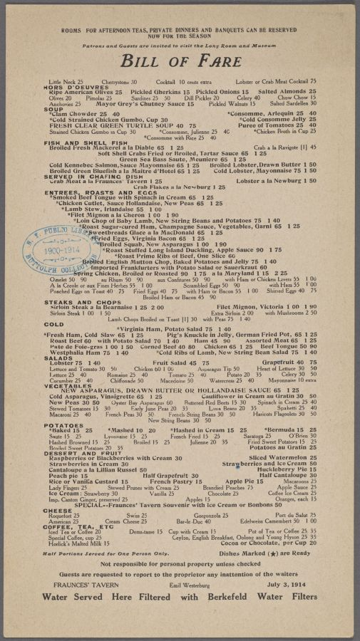
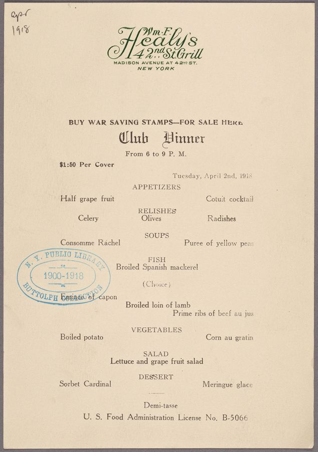
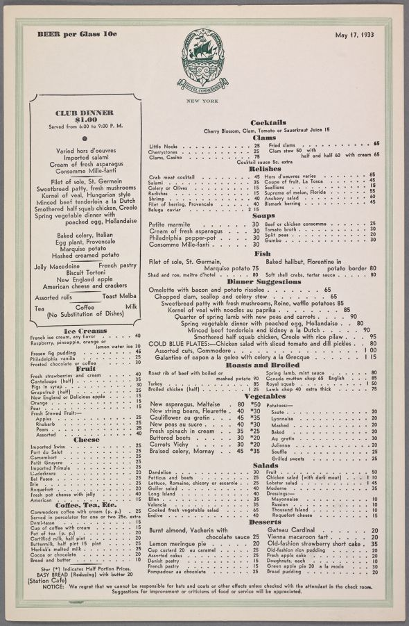
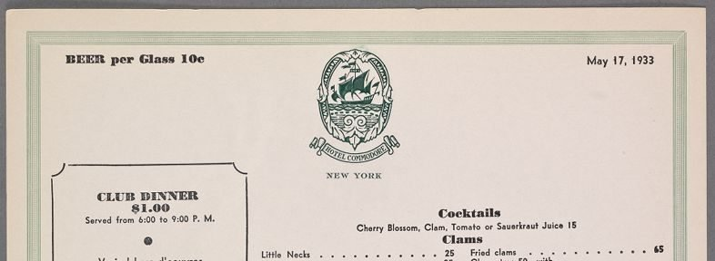
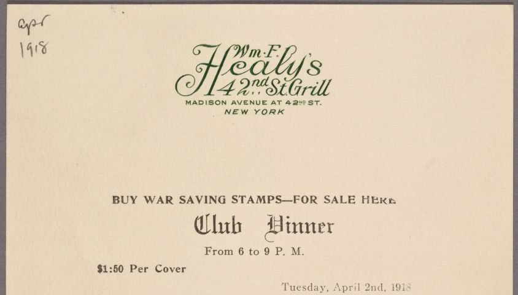

Restaurant menus record history. Menus from 1914 to 1949 urged diners to
buy war stamps during two world wars, and dropped their drink lists during
Prohibition, the US ban on alcohol from 1920 to 1933. We use Quail to find
both events in 1,446 scanned menus. One SQL query reads every menu in 34
seconds on one H100.

## The dataset

The New York Public Library's
[What's on the menu?](https://www.nypl.org/research/support/whats-on-the-menu)
project has scanned 17,547 restaurant menus, most from 1900 to 1960.
Volunteers transcribed each menu's dishes and prices into CSV files. The
volunteers skipped everything else on the page, such as a note about war
stamps or a list of wines. The model reads the rest from the scans.

The menus range from hotel dining rooms to a banquet on an ocean liner.
Click a menu to open the full scan:

<div className="menu-gallery">
  <figure>

[](https://iiif.nypl.org/iiif/2/4066748/full/!2400,2400/0/default.jpg)

    <figcaption>Fraunces' Tavern, New York, July 1914</figcaption>
  </figure>
  <figure>

[](https://iiif.nypl.org/iiif/2/4049267/full/!2400,2400/0/default.jpg)

    <figcaption>Healy's 42nd St. Grill, New York, April 1918: "Buy war saving stamps"</figcaption>
  </figure>
  <figure>

[](https://iiif.nypl.org/iiif/2/4021318/full/!2400,2400/0/default.jpg)

    <figcaption>R.M.S. Berengaria, November 1926: a dinner on board the Cunard liner</figcaption>
  </figure>
  <figure>

[](https://iiif.nypl.org/iiif/2/4021321/full/!2400,2400/0/default.jpg)

    <figcaption>The same dinner's menu: Canada Dry and White Rock, but no liquor</figcaption>
  </figure>
  <figure>

[](https://iiif.nypl.org/iiif/2/4016351/full/!2400,2400/0/default.jpg)

    <figcaption>The Commodore Hotel, New York, May 1933: "Beer per glass 10c"</figcaption>
  </figure>
  <figure>

[](https://iiif.nypl.org/iiif/2/3990440/full/!2400,2400/0/default.jpg)

    <figcaption>The Hotel New Yorker, December 1945: a Victory Loan ad beside the cocktails</figcaption>
  </figure>
</div>

## Loading the tables

We start with the volunteers' CSV files. The code below downloads the files,
keeps the menus from 1914 to 1949, and counts the dishes transcribed on each
page.

```python
import io
import random
import tarfile
import urllib.request
from concurrent.futures import ThreadPoolExecutor

import pyarrow as pa
import pyarrow.csv as csv

DATA = "https://s3.amazonaws.com/menusdata.nypl.org/gzips/2021_08_01_07_01_17_data.tgz"
with urllib.request.urlopen(DATA) as response:
    archive = tarfile.open(fileobj=io.BytesIO(response.read()))


def read(name):
    member = next(m for m in archive.getmembers() if m.name.endswith(name))
    return csv.read_csv(archive.extractfile(member),
                        parse_options=csv.ParseOptions(newlines_in_values=True))


menus = [m for m in read("Menu.csv").to_pylist()
         if m["date"] and 1914 <= m["date"].year <= 1949]
years = {m["id"]: m["date"].year for m in menus}
counts = read("MenuItem.csv").group_by("menu_page_id").aggregate([("id", "count")])
dishes = dict(zip(counts["menu_page_id"].to_pylist(), counts["id_count"].to_pylist()))
```

## Picking one page per menu

Most menus have several pages, and the first page is often a cover. We take
each menu's page with the most transcribed dishes. Some years have hundreds
of menus and others have few, so we keep at most 60 menus per year.

```python
best = {}
for page in read("MenuPage.csv").to_pylist():
    menu = page["menu_id"]
    if menu in years and dishes.get(page["id"], 0) > dishes.get(best.get(menu, {}).get("id"), -1):
        best[menu] = page

by_year = {}
for menu, page in best.items():
    by_year.setdefault(years[menu], []).append(page)
chooser = random.Random(0)
chosen = [page for found in by_year.values()
          for page in chooser.sample(found, min(60, len(found)))]
```

The library's image server resizes each scan on request. We ask for 1,024
pixels on the long side. The model misread more small print at 512 or 768
pixels, and larger images cost more tokens.

```python
def fetch(page):
    url = f"https://iiif.nypl.org/iiif/2/{page['image_id']}/full/!1024,1024/0/default.jpg"
    try:
        with urllib.request.urlopen(url, timeout=15) as response:
            return response.read()
    except OSError:
        return None


with ThreadPoolExecutor(64) as pool:
    fetched = [(page, image) for page, image in zip(chosen, pool.map(fetch, chosen))
               if image]
```

One request in 9 times out, so 1,446 of the 1,637 pages arrive. The image
below shows the top of page `62899`, from the Commodore Hotel in May 1933:



## Registering the tables

Quail reads two tables. `menus` holds one row per menu, and `pages` holds
the image we fetched for each menu:

| Table | Column | Type | Example |
| --- | --- | --- | --- |
| `menus` | `id` | `STRING` | `31142` |
| | `sponsor` | `STRING` | The Commodore Hotel |
| | `year` | `INT64` | 1933 |
| `pages` | `id` | `STRING` | `62899` |
| | `menu_id` | `STRING` | `31142` |
| | `image` | `BINARY` | the JPEG shown above |

```python
import quail

menus = pa.table({"id": [str(m["id"]) for m in menus],
                  "sponsor": [m["sponsor"] for m in menus],
                  "year": [m["date"].year for m in menus]})
pages = pa.table({"id": [str(page["id"]) for page, _ in fetched],
                  "menu_id": [str(page["menu_id"]) for page, _ in fetched],
                  "image": pa.array([image for _, image in fetched], pa.binary())})

config = quail.EngineConfig(model="qwen3.5-4b-bf16", device="h100-sxm")
session = quail.Session(config=config)
session.register("menus", quail.DocumentProvider.from_table(menus, id_col="id"))
session.register("pages", quail.DocumentProvider.from_table(pages, id_col="id"))
```

## Asking the questions

We ask each page two questions: does the menu sell alcohol, and does the
menu mention a war? `AI.IF` asks the model a yes-or-no question about each
image and returns `TRUE` or `FALSE`. An ordinary `GROUP BY` counts the yes
answers per year:

```python
QUERY = """
WITH answers AS (
  SELECT p.menu_id,
         AI.IF(PROMPT('Does this menu sell beer, wine, or liquor to drink? Dishes cooked with wine or liqueur do not count. {0}', p.image)) AS sells_drinks,
         AI.IF(PROMPT('Does this menu mention a war, rationing, or a meatless or wheatless day? {0}', p.image)) AS mentions_war
  FROM pages p)
SELECT m.year, COUNT(*) AS menus,
       ROUND(AVG(CASE WHEN a.sells_drinks THEN 1.0 ELSE 0.0 END), 3) AS drinks,
       ROUND(AVG(CASE WHEN a.mentions_war THEN 1.0 ELSE 0.0 END), 3) AS war
FROM answers a JOIN menus m ON a.menu_id = m.id
GROUP BY m.year HAVING COUNT(*) >= 20
ORDER BY m.year
"""
print(session.sql(QUERY).collect())
session.close()
```

The alcohol question says "to drink" on purpose. The model counted desserts
made with port or kirsch as alcohol without the phrase.

Quail reads each image only once, though both questions read the image. The
second `AI.IF` reuses the KV, the model's saved state for the image, from
the first `AI.IF`, and pays only for its own question.

## Results

The query read 1,446 pages in 34 seconds on one H100 with
`qwen3.5-4b-bf16`. The model read 2.1 million input tokens, and the query
cost $0.04. The query returns one row for each year with at least 20 menus:

<MenuHistoryTable />

The chart plots both shares by year. Hover over the chart to read a year's
numbers, or click a legend entry to hide a line:

<MenuHistoryChart />

War mentions jump from almost none to 57% of menus in 1918, the final year
of World War I, and rise again from 1943 to 1946. Alcohol drops from 36% of
menus in 1914 to under 10% for most of Prohibition. Alcohol returns on 30%
of menus in 1933, the year beer became legal again.

Some menus still list drinks during the ban. The model got at least one of
them wrong: the 1926 Berengaria menu in the gallery lists only mixers.

The war notes stand out on the pages themselves:

<div className="menu-scans">
  <figure>



    <figcaption>Healy's 42nd St. Grill, New York, April 1918</figcaption>
  </figure>
  <figure>


    <figcaption>The Hotel New Yorker, October 1945</figcaption>
  </figure>
</div>

## A note on accuracy

A 4-billion-parameter model handles broad questions like ours well, but
misreads small print. The model read a dish's price right on only 67% of
900 menus with typed-in prices. A few misread pages barely move a share
across many menus. Check the scan before you trust any single answer.
