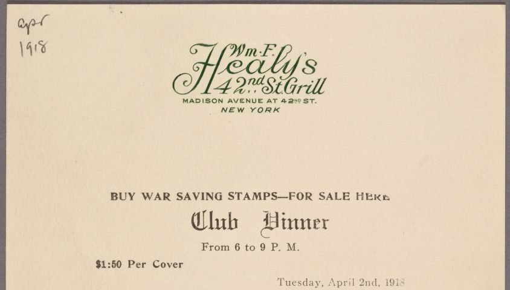
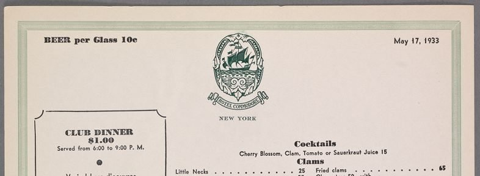

The New York Public Library's
[What's on the menu?](https://www.nypl.org/research/support/whats-on-the-menu)
collection holds 17,547 restaurant menus from the 1850s to the 2010s.
Volunteers typed in each menu's dishes and prices, but not the notes
printed around them. Quail reads the scanned pages, so you can ask about
what nobody typed in.

The query below asks two questions of one page from each of 1,260
menus from 1914 to 1937: does the menu sell drinks, and does it mention a
war? The query ran in 34.5 seconds on one H100 with `qwen3.5-4b-bf16`, for
$0.04.

<MenuHistoryChart />

The two lines follow the history of the period:

- **War:** the US fought in World War I from April 1917 to November 1918.
  Restaurants sold war savings stamps and printed their US Food
  Administration license on the menu. 57% of the 1918 menus mention the
  war.
- **Prohibition:** the ban on alcohol began in January 1920. Menus that
  sell drinks fell from 29% in 1914 to 4–6% from 1919 to 1932. Some of the
  menus that still sold drinks came from foreign ocean liners, such as the
  Cunard liner *Berengaria*.
- **Repeal:** beer became legal again in April 1933, and 36% of the 1933
  menus sell drinks.



Healy's 42nd St. Grill, New York, April 2, 1918: "Buy war saving stamps,
for sale here."



The Commodore Hotel, New York, May 17, 1933: "Beer per glass 10c," six
weeks after beer became legal again.

## Load the menus

The code below downloads the volunteers' tables, keeps up to 100 menus a
year from 1914 to 1937, and fetches the page of each menu with the most
typed-in dishes. The library's image server returns each page as a JPEG at
1,024 pixels, the size the model reads.

```python
import io
import random
import tarfile
import urllib.request
from concurrent.futures import ThreadPoolExecutor

import pyarrow as pa
import pyarrow.csv as csv

DATA = "https://s3.amazonaws.com/menusdata.nypl.org/gzips/2021_08_01_07_01_17_data.tgz"
with urllib.request.urlopen(DATA) as response:
    archive = tarfile.open(fileobj=io.BytesIO(response.read()))


def read(name):
    member = next(m for m in archive.getmembers() if m.name.endswith(name))
    return csv.read_csv(archive.extractfile(member),
                        parse_options=csv.ParseOptions(newlines_in_values=True))


# each menu's year, and each page's number of typed-in dishes
years = {m["id"]: m["date"].year for m in read("Menu.csv").to_pylist()
         if m["date"] and 1914 <= m["date"].year <= 1937}
counts = read("MenuItem.csv").group_by("menu_page_id").aggregate([("id", "count")])
dishes = dict(zip(counts["menu_page_id"].to_pylist(), counts["id_count"].to_pylist()))

# each menu's page with the most dishes, and up to 100 menus a year
best = {}
for page in read("MenuPage.csv").to_pylist():
    menu = page["menu_id"]
    if menu in years and dishes.get(page["id"], 0) > dishes.get(best.get(menu, {}).get("id"), -1):
        best[menu] = page
by_year = {}
for menu, page in best.items():
    by_year.setdefault(years[menu], []).append(page)
chooser = random.Random(0)
chosen = [page for found in by_year.values()
          for page in chooser.sample(found, min(100, len(found)))]


def fetch(page):
    url = f"https://iiif.nypl.org/iiif/2/{page['image_id']}/full/!1024,1024/0/default.jpg"
    try:
        with urllib.request.urlopen(url, timeout=15) as response:
            return response.read()
    except OSError:
        return None


with ThreadPoolExecutor(64) as pool:
    fetched = [(page, image) for page, image in zip(chosen, pool.map(fetch, chosen))
               if image]
```

The image server skips about 1 page in 10, so you get about 1,260 of the
1,402 pages.

## Ask the scans

Register the two tables, and run the query:

```python
import quail

menus = pa.table({"id": [str(menu) for menu in years],
                  "year": list(years.values())})
pages = pa.table({"id": [str(page["id"]) for page, _ in fetched],
                  "menu_id": [str(page["menu_id"]) for page, _ in fetched],
                  "image": pa.array([image for _, image in fetched], pa.binary())})

config = quail.EngineConfig(model="qwen3.5-4b-bf16", device="h100-sxm")
with quail.Session(config=config) as session:
    session.register("menus", quail.DocumentProvider.from_table(menus, id_col="id"))
    session.register("pages", quail.DocumentProvider.from_table(pages, id_col="id"))
    print(session.sql(QUERY).collect())
```

`QUERY` is the SQL below. A common table expression (CTE) asks both
questions of each page, and DataFusion joins the answers to each menu's
year:

```sql
WITH answers AS (
  SELECT p.menu_id,
         AI.IF(PROMPT('Does this menu sell beer, wine, or liquor to drink? Dishes cooked with wine or liqueur do not count. {0}', p.image)) AS sells_drinks,
         AI.IF(PROMPT('Does this menu mention a war, rationing, or a meatless or wheatless day? {0}', p.image)) AS mentions_war
  FROM pages p)
SELECT m.year, COUNT(*) AS menus,
       ROUND(AVG(CASE WHEN a.sells_drinks THEN 1.0 ELSE 0.0 END), 3) AS drinks,
       ROUND(AVG(CASE WHEN a.mentions_war THEN 1.0 ELSE 0.0 END), 3) AS war
FROM answers a JOIN menus m ON a.menu_id = m.id
GROUP BY m.year HAVING COUNT(*) >= 20
ORDER BY m.year
```

The query returns one row per year with at least 20 menus:

| year | menus | drinks | war |
| --- | --- | --- | --- |
| 1914 | 99 | 0.293 | 0.01 |
| 1917 | 100 | 0.12 | 0.21 |
| 1918 | 100 | 0.1 | 0.57 |
| 1919 | 99 | 0.04 | 0.051 |
| 1921 | 100 | 0.04 | 0.02 |
| 1932 | 53 | 0.057 | 0 |
| 1933 | 100 | 0.36 | 0 |
| 1937 | 93 | 0.215 | 0 |

The sample is random, so your counts can differ slightly.

The query runs fast because the model reads each page once. Quail answers
the second `AI.IF` from the KV the first `AI.IF` already computed for the
page.

## Know the limits

- **Small text:** the 4B model reads broad questions well, but misreads
  small print. On menus with typed-in prices, the model named the currency
  right on 87% of the pages, and one dish's price on 67%.
- **Few menus:** the collection holds fewer than 60 menus a year from 1922
  to 1932, so the query leaves out the years with fewer than 20.
- **Wording:** ask about drinks "to drink". Asked only about beer, wine, or
  liquor, the model also counted desserts made with port or kirsch.

[Querying multimodal data](/docs/user-guide/multimodal-data) explains how
Quail reads images and PDFs.
