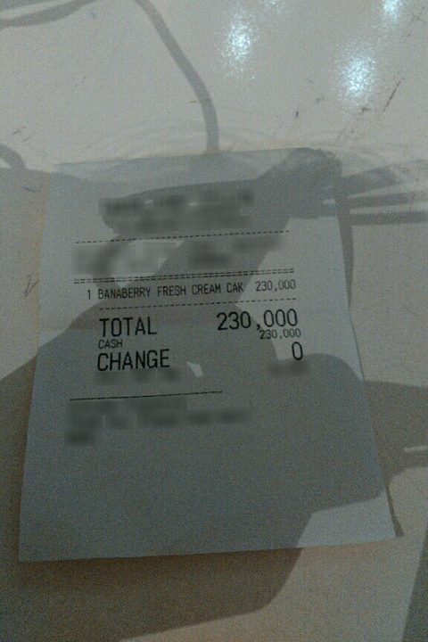

`AI.IF`, `AI.SCORE`, `AI.CLASSIFY`, and `AI.MAP` read PNG and JPEG images
stored in a `BINARY` column, just as they read text columns. `AI.PDF_PAGES`
renders each page of a PDF as a PNG image so a vision model, a language model
able to read images, can read page layouts and scanned pages.
`AI.PARSE_DOCUMENT` reads the text stored inside a PDF instead, without optical
character recognition (OCR), which reads text from pictures. Use `AI.PDF_PAGES`
for most PDF queries, and use `AI.PARSE_DOCUMENT` when a text-only model runs
the query or when `AI.EXTRACT` copies answers from stored text.

## Vision models

Configure the session with a vision model when your query reads images or
`AI.PDF_PAGES` output:

- `qwen3.5-4b-fp8` or `qwen3.5-4b-bf16`
- `qwen3.5-27b-fp8`
- `qwen3.6-35b-a3b-fp8`
- `qwen3.8-27b-fp8`
- `qwen3.8-27b-nvfp4` (B200 only)

[Models and GPUs](/docs/user-guide/models) lists the GPUs able to run each
model.

## Images

Store PNG or JPEG bytes in a `BINARY` column to query images. You can test
image queries on
[CORD](https://huggingface.co/datasets/naver-clova-ix/cord-v2), a dataset of
1,000 receipt photos from Indonesian restaurants priced in rupiah.

Download the CORD Parquet files and store each photo's bytes in a `BINARY`
column:

```python
import pyarrow as pa
import pyarrow.parquet as pq
from huggingface_hub import HfApi, hf_hub_download

repo = "naver-clova-ix/cord-v2"
names = [name for name in HfApi().list_repo_files(repo, repo_type="dataset")
         if name.endswith(".parquet")]
photos = pa.concat_tables(
    pq.read_table(hf_hub_download(repo, name, repo_type="dataset"), columns=["image"])
    for name in sorted(names))
images = [image["bytes"] for image in photos.column("image").to_pylist()]
receipts = pa.table({
    "id": [f"r{index}" for index in range(len(images))],
    "image": pa.array(images, pa.binary()),
})
```

Register `receipts` in a session configured with a vision model:

```python
import quail

config = quail.EngineConfig(model="qwen3.5-4b-bf16", device="h100-sxm")
session = quail.Session(config=config)
session.register("receipts", receipts, id_col="id")
```

Pass `r.image` to an AI function in SQL. `AI.IF` keeps each receipt with a
total over 100,000 rupiah, and `AI.CLASSIFY` labels what each kept receipt
paid for:

```sql
SELECT r.id,
       AI.CLASSIFY(r.image, ['meal', 'drinks only', 'bakery or snacks']) AS category
FROM receipts r
WHERE AI.IF(PROMPT('Is this receipt''s total over 100,000 rupiah? {0}', r.image));
```

|  |  |  |
| --- | --- | --- |
| 174,600: returned, `meal` | 230,000: returned, `bakery or snacks` | 91,000: filtered out |

You pay to encode each receipt once because `AI.CLASSIFY` reuses KV, the
model's cached attention state, from `AI.IF` on each passing receipt. You get
answers for all 1,000 receipts in 92 seconds ($0.10) on one H100 with
`qwen3.5-4b-bf16`, matching 96.8% of the 972 receipts with a labeled total.

### Shrink large images

Vision models read one token per 32 by 32 pixels, so large photos cost
thousands of tokens. `AI.IMAGE(image, longest_edge)` shrinks an image on the
CPU so its longer side is at most `longest_edge` pixels:

```sql
SELECT r.id,
       AI.CLASSIFY(AI.IMAGE(r.image, 1024),
                   ['meal', 'drinks only', 'bakery or snacks']) AS category
FROM receipts r
WHERE AI.IF(PROMPT('Is this receipt''s total over 100,000 rupiah? {0}',
                   AI.IMAGE(r.image, 1024)));
```

`AI.IMAGE(r.image, 1024)` runs the CORD query 4 times faster and lowers filter
accuracy by 0.1 percentage points.

## PDFs

Store PDF bytes in a `BINARY` column to query PDFs from a folder such as
`contracts`:

```python
from pathlib import Path

paths = sorted(Path("contracts").glob("*.pdf"))
files = pa.table({
    "path": [path.name for path in paths],
    "pdf": pa.array([path.read_bytes() for path in paths], pa.binary()),
})
session.register("files", files, id_col="path")
```

### Query individual pages

`AI.PDF_PAGES(pdf[, longest_edge[, first[, last]]])` renders each page as a
struct with `page`, the page number starting at 1, and `image`, a PNG image.
`UNNEST` expands the list of structs into one row per page. Filter the unnested
pages with `AI.IF` to find each contract page containing a liability cap, a
clause limiting how much one party can owe:

```sql
SELECT p.path, p.u['page'] AS page
FROM (SELECT f.path, UNNEST(AI.PDF_PAGES(f.pdf, 1024)) AS u FROM files f) p
WHERE AI.IF(PROMPT('Does the page cap either party''s liability? {0}',
                   p.u['image']));
```

### Query a whole PDF

Pass the list from `AI.PDF_PAGES` directly to an AI function when a question
spans several pages. The AI function reads the rendered pages together as one
document. Pass `first` and `last` to render only a range of pages on long PDFs:

```sql
SELECT f.path,
       AI.CLASSIFY(AI.PDF_PAGES(f.pdf, 1024, 1, 3),
                   ['lease', 'invoice', 'annual report', 'other']) AS kind
FROM files f;
```

Set `longest_edge` to balance small-print accuracy against token count.
`longest_edge` defaults to 1,536 pixels, and a US Letter page at 1,024 pixels
uses 800 tokens.

### Read stored PDF text

`AI.PARSE_DOCUMENT(pdf)` reads the text stored inside a PDF on the CPU and
separates pages with a form feed character (`'\f'`). Use `AI.PARSE_DOCUMENT`
with `AI.EXTRACT`, which copies exact spans from text and rejects images:

```sql
SELECT f.path,
       AI.EXTRACT(AI.PARSE_DOCUMENT(f.pdf),
                  {'effective_date': 'What is the effective date?'}) AS answers
FROM files f;
```

`AI.PARSE_DOCUMENT` returns an empty string for a scanned page because a scan
stores page pictures rather than text, and returns `NULL` when a PDF is `NULL`
or unreadable.

[AI functions](/docs/user-guide/sql/ai-functions) describes every argument of
`AI.PDF_PAGES`, `AI.PARSE_DOCUMENT`, and `AI.IMAGE`. CORD (Park et al., 2019)
provides the receipt photos under
[CC BY 4.0](https://creativecommons.org/licenses/by/4.0/).
