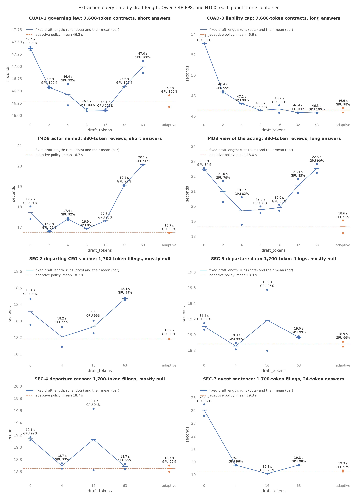
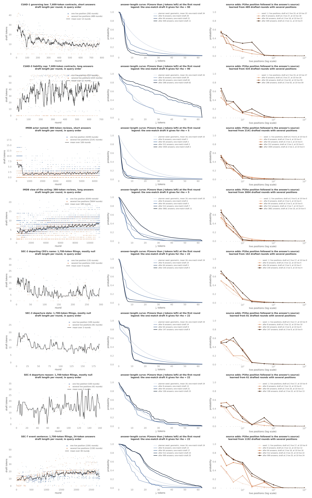

# The draft length of an AI.EXTRACT round: a fixed sweep against the adaptive policy

Date: 2026-10-16.

AI.EXTRACT fed 16 draft tokens per round because 16 was the default,
not because anything measured it. Measured on eight extraction queries,
the best fixed draft length is 2 on one query and 63 on another, and
the wrong fixed length costs up to 7 s of a 46 s query. The adaptive
policy, which picks each round's draft length from the document's KV
read and two curves it learns during the query, is within 0.3 s of the
best fixed length on every query without being told which that is, and
1.1 s ahead on one. It is now the default
([33b1fbb](https://github.com/fsdatalab/quail/commit/33b1fbb)).

## What a round is, and what the draft costs

An extraction writes an answer by copying tokens from the document. A
round is one forward pass over a document's KV with a few fed tokens:
the token the model chose last round, then a draft of the document's
next tokens after the position the answer so far matches. A readout
row after each fed token says whether the model would have chosen the
next draft token. Accepted draft tokens are written in one round
instead of one per round.

The round's cost in fed-token equivalents is `1 + γ + ρ`, with γ the
draft length and ρ the KV read of the whole document per round. Both
prices come from the roofline, not from measured passes:

- One fed token costs `2 × parameters / peak FP8 FLOPs`, 3.7 µs on
  Qwen3 4B on an H100.
- Reading a document of L tokens costs `L × κ / HBM bandwidth`, with κ
  the KV bytes per token. Divided by the token price it is ρ, the read
  in fed tokens: about 90 for a 7,600-token CUAD contract, 22 for a
  1,700-token SEC filing, 5 for a 380-token IMDB review.

The draft itself is free to produce: the tokens are already in the
document. There is no draft model, so the speculative-decoding cost
model of a draft model does not apply. The only costs are the fed
tokens and the round.

## Planning: what the planner knows

The planner sets two numbers on the extraction plan
(`quail/planner/operators/extract.py`):

- `round_cost_per_token`, κ over bandwidth over the token price, so the
  executor can compute ρ per document from its prompt length.
- `expected_answer_tokens`, a guess at the mean answer length, 16. It
  seeds the answer-length curve as a geometric curve and fades once
  answers settle.

The planner assumes no saved statistics. Its cost estimate for the
operator (`quail/cost/extract.py`) prices the first round's draft from
the same policy the executor runs, with the seed curve, and counts
rounds from the seed curve.

## Execution: the policy

Per document and round (`quail/cost/draft_policy.py`, called from
`Decoder.draft`):

- `surv(j)`, the answer-length curve: P(the answer has more than j
  tokens left). The seed is geometric with mean 16, weighted as 8
  settled answers; each settled answer's length is added to a
  histogram, and the curve is the blend, so the seed fades after a few
  dozen answers.
- `a(m)`, the source odds: P(the position the draft follows is the
  answer's true source) when m document positions match the answer so
  far. With one match, 1. The seed is `1/m`, weighted as 8 rounds; each
  drafted round with m > 1 reports whether its first draft token was
  written, bucketed by m on a log scale.
- Expected tokens a draft of γ writes: `N(γ) = 1 + a(m) × Σ_{j=1..γ} surv(j)`.
- The round feeds `γ = argmin (1 + γ + ρ) / N(γ)`, capped at
  `draft_tokens` (63 by default) and the answer limit. ρ is rounded to
  a log-scale bucket, and the results are cached per (ρ bucket,
  written tokens, m bucket) until a curve changes at a power of two.

Verification stays on the host. A device-side verifier was built and
matched the host decoder, but gave no change in query time because
the host had been blocked on the readout's launch queue, not on
comparing tokens; deciding earlier passes before submitting a readout
fixed that, and the device path is off by default.

## Setup

- Queries: four from the earlier grid, chosen to cover long and short
  documents against long and short answers, and four over the SEC 8-K
  filings of quail-bench PR 50.
  - CUAD-1, governing law, and CUAD-3, liability cap, over 449
    contracts at sf 1.0, 7,600 tokens each on average.
  - Two ad hoc extractions over 5,000 IMDB reviews at sf 0.1, 380
    tokens each: "Which actor does the reviewer name?" and "What does
    the reviewer say about the acting?".
  - SEC-2 name, SEC-3 date, SEC-4 reason, and SEC-7 event sentence, as
    ad hoc extractions over the first 1,000 of the 100,000 filings,
    1,700 tokens each. The prompts are the PR's at commit e7255c2;
    SEC-7's is the sentence under the first Item, which that PR's
    later commit 4bc613e adds as a query. Five filings hold U+037E,
    which the tokenizer normalizes, so the texts are NFC-normalized.
- Model and device: Qwen3 4B FP8 on one H100 on Modal, Quail backend.
- Sweep: draft lengths 0, 2, 4, 8, 16, 32, 63 and the adaptive policy
  on CUAD and IMDB; 0, 4, 16, 63 and adaptive on SEC. Each query ran in
  one container, every setting three times in round-robin order; the
  first pass over the settings is the warmup and is left out, so each
  setting has two measured runs. Query time includes planning and
  excludes model startup. GPU busy is the share of the timed window
  with a forward pass or readout running.
- Cell: `experiments/cells/extract_draft.py` at 33b1fbb.
- Prediction, written before the same-container sweeps: the adaptive
  policy lands within 0.2 s of the best fixed draft on every query and
  below it on CUAD-3. Result: within 0.3 s on every query, below the
  best fixed on four, above on CUAD-3 by 0.27 s.

Records, on the `quail-results` volume under
`/results/ablations/extract_draft/`:

| Query | Sweep record | Function call | Adaptive trace |
|---|---|---|---|
| CUAD-1 | `finalcuad1-CUAD-1-sf1.0-qwen3-4b-fp8-d16.json` | fc-01M5389ZZ5FPEPK9KWQYMAKQNV | `tracecuad1-...-dadaptive.json` |
| CUAD-3 | `finalcuad3-CUAD-3-sf1.0-qwen3-4b-fp8-d16.json` | fc-01M538A2YB8NBZK2BB6ZSQX1VR | `tracecuad3-...-dadaptive.json` |
| IMDB actor | `finalactor-reviews-sf0.1-qwen3-4b-fp8-d16.json` | fc-01M5389M8TZBYRRBFHP3TJ079Q | `traceactor-...-dadaptive.json` |
| IMDB acting | `finalacting-reviews-sf0.1-qwen3-4b-fp8-d16.json` | fc-01M5389M3AWXVNK9P20ENR8H99 | `traceacting-...-dadaptive.json` |
| SEC-2 name | `finalsecname-sec_filings-sf1.0-qwen3-4b-fp8-d16.json` | fc-01M5389N83YKJB3CN4DXSVFN1Z | `tracesecname-...-dadaptive.json` |
| SEC-3 date | `finalsecdate-sec_filings-sf1.0-qwen3-4b-fp8-d16.json` | fc-01M5389MHXFV50FVQY5F8H8XME | `tracesecdate-...-dadaptive.json` |
| SEC-4 reason | `finalsecreason-sec_filings-sf1.0-qwen3-4b-fp8-d16.json` | fc-01M5389MVR63A9PF8VW4XKBSCS | `tracesecreason-...-dadaptive.json` |
| SEC-7 event sentence | `finalsecevent-sec_filings-sf1.0-qwen3-4b-fp8-d16.json` | fc-01M5389MWE87HYDC1D7CCHY382 | `tracesecevent-...-dadaptive.json` |

The plot script is `reports/make_extract_draft_plots.py`; its docstring
lists the `modal volume get` commands.

## Results

Query time, mean of the two measured runs, with the best fixed draft
length in parentheses:

| Query | No draft | Best fixed | Adaptive | Adaptive against best fixed |
|---|---|---|---|---|
| CUAD-1 governing law | 47.37 s | 46.10 s (16) | 46.29 s | +0.19 s |
| CUAD-3 liability cap | 53.12 s | 46.33 s (63) | 46.60 s | +0.27 s |
| IMDB actor named | 17.71 s | 16.80 s (2) | 16.73 s | −0.07 s |
| IMDB view of the acting | 22.48 s | 19.70 s (4) | 18.64 s | −1.06 s |
| SEC-2 name | 18.36 s | 18.20 s (4) | 18.19 s | −0.01 s |
| SEC-3 date | 19.11 s | 18.85 s (4) | 18.88 s | +0.03 s |
| SEC-4 reason | 19.14 s | 18.68 s (63) | 18.65 s | −0.03 s |
| SEC-7 event sentence | 24.03 s | 19.08 s (16) | 19.29 s | +0.21 s |

- The best fixed draft length is query-dependent: 2, 4, 16, or 63.
  No one constant is right, which was the problem with 16.
- Picking the wrong fixed length costs the most where answers are
  long: 63 against 4 costs 2.8 s on IMDB acting, and 0 against 63
  costs 6.8 s on CUAD-3. Where answers are mostly null, the three SEC
  departure queries, the whole sweep spans under 0.5 s and any policy
  is fine.
- The adaptive policy is within 0.3 s of the best fixed length on all
  eight and ahead on four. Run-to-run spread within a container is
  0.1 to 0.9 s on these queries, so the differences other than IMDB
  acting are within noise.
- GPU busy is 98 to 100% on CUAD and SEC under every setting, 79 to
  96% on IMDB, where the short reviews leave the host per-round cost
  visible. The adaptive runs are at the top of the IMDB range, 93 to
  95%.
- Throughput, as input tokens per second over the whole prompt set,
  is 73,000 on CUAD-1 (3.40 M tokens), 94,000 on SEC-2 (1.70 M), and
  112,000 on IMDB actor (1.87 M), against a roofline of about
  270,000 at 3.7 µs per token. The gap is kernel efficiency on
  prefill, measured earlier at about 52% of roofline, and the draft
  length does not move it.

## How the policy moves during a query

One logged adaptive run per query. Left: the draft length of every
round in query order, blue when one document position matched the
answer so far, orange when several did. Middle: the answer-length
curve replayed after 0, 8, 64, 512, and all settled answers, with the
one-match draft it gives for the query's typical ρ. Right: the source
odds by match count at the same checkpoints, against the `1/m` seed.

- The answer-length curve moves a long way from the seed and settles
  early. On IMDB actor the one-match draft goes from 10 under the seed
  to 2 after 8 answers; on CUAD-3 from 34 to 62. After 64 answers the
  curves are stacked on most queries. CUAD-3's keeps rising to 298
  answers because its long answers settle last.
- The source odds at 2 matches end well above the 0.5 seed on
  long-answer queries, 0.65 on CUAD-3 and 0.93 on SEC-7. At 10 or
  more matches they fall to near zero on every query, where the seed
  was about right. The draft length at 2 matches follows: 11 on
  CUAD-1, 62 on CUAD-3, 25 on SEC-7.
- The draft length settles into a band per query once both curves
  have data: about 10 on CUAD-1, 40 to 60 on CUAD-3, 2 on IMDB actor,
  20 on SEC-7.

## Why not simply skip the draft when several positions match

An earlier version of the policy fed no draft in a round with several
matching positions, on the grounds that the draft might follow the
wrong one. Paired runs on one GPU, alternating that rule with a
2-token draft, three pairs each with the first dropped as warmup
(fc-01M532X93TAG8A4W973WDP11QZ, fc-01M532X3X9DR0NP6YZ3NZFQ0AT,
fc-01M532WSF70VA460PX4HPHGG6V, fc-01M532WT7GV6A55QX3EV0P074X):

| Query | No draft when several match | 2-token draft | Rounds |
|---|---|---|---|
| CUAD-1 | 47.0 s | 46.3 s | 1673 against 1331 |
| CUAD-3 | 46.8 s | 46.3 s | 1518 against 1247 |
| IMDB actor | 17.1 s | 17.1 s | 12554 against 11225 |
| IMDB acting | 19.2 s | 19.7 s | 17439 against 16561 |

Skipping the draft costs a quarter more rounds on the long documents
and 0.5 to 0.7 s, about 1.5%, for the same GPU seconds; the loss is
host time per round. The reason is ρ: a round over a 7,600-token
contract costs 90 fed tokens, so a 2-token draft that saves a round
half the time pays for itself many times over. The source odds `a(m)`
price that bet instead of a rule, and the final policy takes 1230
rounds on CUAD-1 against 1213 for a fixed 16.

## What remains uncertain

- One model and device. ρ scales with κ over bandwidth over the token
  price, so the policy's choices shift on Qwen3 32B and on
  DiffusionGemma, where κ differs; the curves are learned per query and
  should carry over, but nothing here measures it.
- The 0.2 to 0.3 s the adaptive policy trails the best fixed length
  on CUAD-1, CUAD-3, and SEC-7 is at the edge of run-to-run noise. If
  real, the cause is the early rounds before the curves have data, when
  the `1/m` seed is too pessimistic at 2 matches. A faster seed from
  the first drafted rounds would settle it; a constant would not.
- The prior weights of 8 settled answers and 8 drafted rounds, the
  seed of 16 expected answer tokens, and the ρ and m bucket edges are
  chosen numbers. They set how fast the seed fades and the table
  resolution, not a decision, and none was swept.
- The host-side profile of SEC-7 puts about 2 s of a 19 s query in
  tokenizing the document along the matched position to produce draft
  tokens, under any draft length. That is the next host cost to look
  at for extraction.
